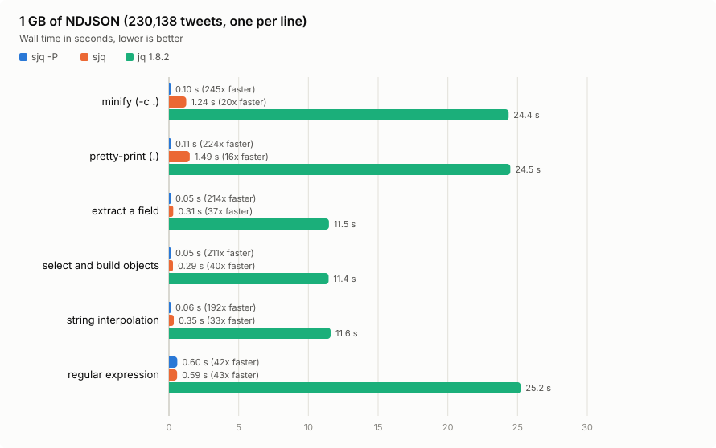
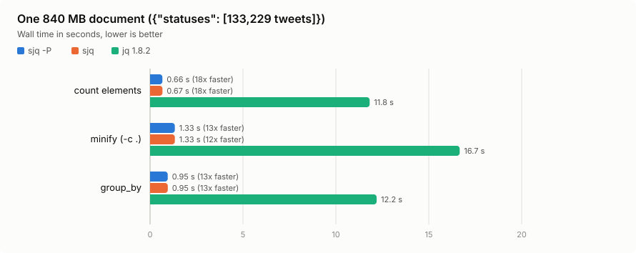

# sjq

[](https://github.com/simdjson/sjq/actions/workflows/ci.yml)

A fast, jq-compatible command-line JSON processor built on
[simdjson](https://github.com/simdjson/simdjson).

```
sjq '.statuses[] | {id, name: .user.name}' twitter.json
```

sjq reads the [jq language](https://jqlang.org/manual/): the filters you
write for jq work with sjq, and on large inputs they run ten to a hundred
times faster. Documentation: **https://simdjson.github.io/sjq/**

## Install

Linux and macOS:

```
curl -fsSL https://raw.githubusercontent.com/simdjson/sjq/main/install.sh | sh
```

Windows (PowerShell):

```
irm https://raw.githubusercontent.com/simdjson/sjq/main/install.ps1 | iex
```

With a package manager:

```
brew install simdjson/tap/sjq                          # Homebrew (macOS, Linux)
scoop bucket add sjq https://github.com/simdjson/sjq   # Scoop (Windows)
scoop install sjq/sjq
```

The scripts download the binary for your system from the latest
[release](https://github.com/simdjson/sjq/releases) and check its SHA-256
checksum. The Linux binaries are static (x86-64 and ARM64), the macOS binary
is universal, and Windows has x64 and ARM64 builds. One binary per system is
enough: simdjson picks the fastest code for the processor at run time.

From source (CMake 3.15+, a C++17 compiler; CMake downloads simdjson 5.3.0,
or uses an installed one with `-D SJQ_SYSTEM_SIMDJSON=ON`):

```
cmake -B build
cmake --build build
ctest --test-dir build --output-on-failure
cmake --install build
```

## Windows: quoting

- Command Prompt (cmd): single quotes are not quotes. Use double quotes, with
  `\"` inside: `sjq "select(.name == \"x\")" file.json`.
- Windows PowerShell 5 strips the double quotes inside arguments:
  `'."année"'` reaches sjq as `.année`.
- In both, put the filter in a file: `sjq -f filter.jq file.json`.
- PowerShell 5's `>` writes UTF-16: use `sjq -o out.json ...` instead, and
  sjq writes UTF-8 itself. sjq reads UTF-16 files with a byte order mark.

## Invalid JSON

Filters that only navigate and select (`.a.b`, `select(...)`, `{id, name}`)
run on simdjson's On-Demand API, which parses only what the filter reads: the
parts of a document they skip are not fully checked (`sjq .a` prints `1` for
`{"a": 1, "b": tru}`). Invalid UTF-8, unclosed strings and unbalanced
brackets are caught everywhere. `--no-od` checks every document in full, as
jq does.

## Performance

sjq against jq 1.8.2 on 1 GB of NDJSON and on one 840 MB document (mean wall
time, outputs identical; the [documentation](https://simdjson.github.io/sjq/#performance)
has the method and the table).

<picture>
  <source media="(prefers-color-scheme: dark)" srcset="docs/bench-ndjson-dark.svg">
  
</picture>

<picture>
  <source media="(prefers-color-scheme: dark)" srcset="docs/bench-document-dark.svg">
  
</picture>

## Compatibility

sjq implements the jq 1.8 language:
- paths, `select`, `map`, `reduce`, `foreach` and `def`
- string interpolation and the `@csv`, `@tsv` and `@base64` formats
- assignment (`=`, `|=`, `+=`, ...), `del` and path functions
- destructuring, regular expressions and dates
- `input`/`inputs`, and most options, including `--arg`, `--argjson`, `-s` and `-R`.

sjq also writes JSON in the compact yet readable
[FracturedJson](https://github.com/j-brooke/FracturedJson) layout
(`--fractured`).

728 of the 781 tests of jq's own test suite pass, and the
[jq tutorial](https://jqlang.org/tutorial/) runs unchanged. The differences
are listed in the [documentation](https://simdjson.github.io/sjq/#language).

## Development

- Tests: `ctest --test-dir build` runs:
  - golden cases recorded from jq 1.8.2 (`tests/cases`);
  - targeted tests of memory mapping, pipes, parallel runs and errors;
  - jq's own test suite;
  - with a `jq` in the `PATH`, a comparison of jq's and sjq's outputs.

  See `tests/run_tests.py`.
- Fuzzing: `-D SJQ_FUZZING=ON` with clang builds `fuzz_sjq` (libFuzzer).
- Benchmarks: `bench/`.
- Design notes: `doc/design.md`.

- Releases: push a tag such as `v0.1.0`; the release workflow builds and
  publishes the binaries and `SHA256SUMS`. If GitHub had no macOS runner,
  the release goes out without the macOS binary: run
  `scripts/release-macos.sh v0.1.0` on a Mac to build and attach it.
  Then `scripts/update_packages.sh v0.1.0` updates the Scoop manifest
  (`bucket/`) and the Homebrew tap (simdjson/homebrew-tap), and writes the
  winget manifests for a pull request to microsoft/winget-pkgs.

sjq was first developed in the simdjson repository (simdjson/simdjson#3143).

## License

Apache 2.0 or MIT, at your option, as simdjson. The files under `tests/jq`
come from jq (MIT, see `tests/jq/COPYING`).
