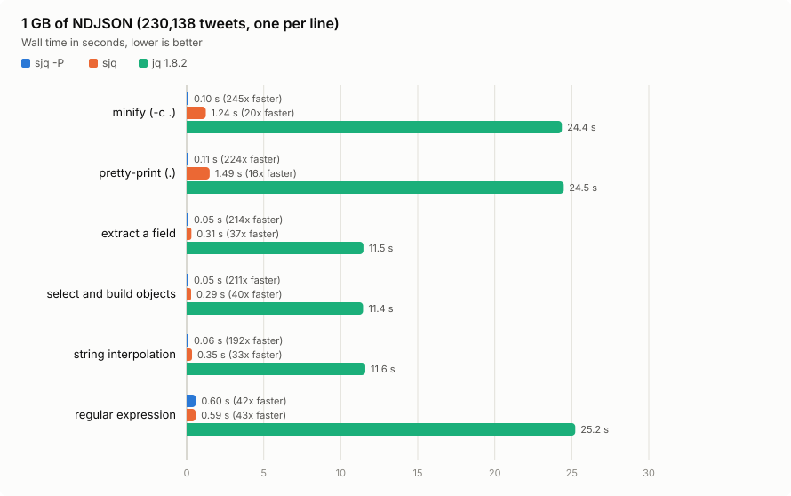
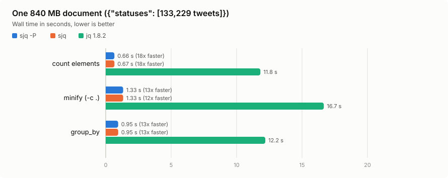

# sjq

<p class="lead">A fast, jq-compatible command-line JSON processor built on
<a href="https://github.com/simdjson/simdjson">simdjson</a>.</p>

```
sjq '.statuses[] | {id, name: .user.name}' twitter.json
```

sjq reads the [jq language](https://jqlang.org/manual/): the filters you
write for jq work with sjq, and they usually run ten to a hundred times
faster on large inputs. sjq parses JSON with simdjson's SIMD instructions,
reads only the parts of a document a filter needs when it can, maps files in
memory instead of copying them, and filters large newline-delimited files on
all cores.

## Install {#install}

**Linux and macOS:**

```
curl -fsSL https://raw.githubusercontent.com/simdjson/sjq/main/install.sh | sh
```

The script downloads the binary for your system from the latest
[release](https://github.com/simdjson/sjq/releases), checks its SHA-256
checksum and installs it in `~/.local/bin` (set `SJQ_INSTALL_DIR` to choose
another directory, `SJQ_VERSION` to pick a release). The Linux binaries are
static: they run on any distribution, x86-64 or ARM64. The macOS binary runs
on Apple silicon and Intel Macs.

**Windows** (PowerShell):

```
irm https://raw.githubusercontent.com/simdjson/sjq/main/install.ps1 | iex
```

It installs `sjq.exe` in `%LOCALAPPDATA%\Programs\sjq` and adds that
directory to your user `PATH`. You can also download the zip files from the
releases page.

**From source** (CMake 3.15 or later, a C++17 compiler):

```
git clone https://github.com/simdjson/sjq.git
cd sjq
cmake -B build
cmake --build build
cmake --install build
```

CMake downloads simdjson; with `-D SJQ_SYSTEM_SIMDJSON=ON` it uses an
installed simdjson (5.3.0 or later) instead.

One binary per system is enough: simdjson detects the processor when sjq
starts and picks the fastest code it supports (AVX-512, AVX2, SSE4.2, NEON
or portable code).

## Usage {#usage}

```
sjq [OPTIONS] FILTER [FILE...]
sjq [OPTIONS] -f FILTER_FILE [FILE...]
```

sjq applies the filter to each JSON value of each file (or of standard input
when there is no file) and writes the results. A file can hold one document,
newline-delimited JSON (NDJSON) or any sequence of whitespace-separated
values. When standard input is a pipe, sjq processes each document as soon as
it arrives, so `tail -f log.ndjson | sjq .level` works.

A few examples:

```
# Pretty-print, or compact with -c.
sjq . data.json
sjq -c . data.json

# Fields of every record of a log, as text.
sjq -r '.user.name' events.ndjson

# Filter and reshape.
sjq -c 'select(.status == 404) | {ip, url}' access.ndjson

# Aggregate.
sjq '[.[] | .price] | add / length' products.json
sjq -s 'group_by(.lang) | map({lang: .[0].lang, n: length})' tweets.ndjson

# Strings, regular expressions, CSV.
sjq -r '.[] | "\(.id)\t\(.name | ascii_downcase)"' users.json
sjq -r '.[] | select(.email | test("@example\\.com$")) | [.id, .email] | @csv' users.json

# Update in place, delete.
sjq '.version |= . + 1 | del(.debug)' config.json

# Variables from the command line.
sjq --arg user alice --argjson limit 10 '.[] | select(.owner == $user) | .size < $limit' files.json
```

### Options

| Option | Meaning |
|---|---|
| `-c`, `--compact-output` | one line per output |
| `-r`, `--raw-output` | write strings without quotes |
| `-j`, `--join-output` | like `-r`, without newlines |
| `--raw-output0` | like `-r`, with a NUL byte after each output |
| `-a`, `--ascii-output` | escape non-ASCII characters (`é`) |
| `-n`, `--null-input` | run the filter once, on `null` (read inputs with `input`, `inputs`) |
| `-s`, `--slurp` | read all inputs into one array |
| `-R`, `--raw-input` | read each line as a string (with `-s`: the whole input as one string) |
| `-e`, `--exit-status` | exit status 1 if the last output is `false` or `null`, 4 if there is none |
| `-S`, `--sort-keys` | sort the keys of objects |
| `-C`, `--color-output` / `-M`, `--monochrome-output` | force or disable colors (on by default on a terminal; `NO_COLOR` and `JQ_COLORS` are honored) |
| `--tab`, `--indent n` | indent with a tab or with n spaces (0 to 7) |
| `-f`, `--from-file file` | read the filter from a file |
| `--arg name value` | set `$name` to a string |
| `--argjson name json` | set `$name` to a JSON value |
| `--slurpfile name file` | set `$name` to an array of the JSON values of a file |
| `--rawfile name file` | set `$name` to the contents of a file |
| `--args`, `--jsonargs` | the remaining arguments are strings (or JSON values), in `$ARGS.positional` |
| `--seq` | write an RS character before each output; read RS-separated input |
| `--unbuffered` | flush the output after each input |
| `-b`, `--binary` | on Windows, write LF line ends |
| `--threads n` | worker threads for large files (1: sequential) |
| `--no-od`, `--no-mmap` | turn off the On-Demand fast path, or memory mapping |
| `-V`, `--version`, `-h`, `--help` | |

The exit status is 0 on success, 2 for usage and file errors, 3 when the
filter does not compile and 5 when the last input fails with an error, as
with jq.

## Performance {#performance}

These charts compare sjq with jq 1.8.2 (the official static Linux binary) on
two inputs built from simdjson's `twitter.json` sample: 1 GB of NDJSON (one
tweet per line) and one 840 MB document. Each bar is the mean wall time of
hyperfine runs (3 for jq, 10 for sjq), with the output written to
`/dev/null`; the outputs of jq and sjq were checked to be identical. "sjq" is
the default (all cores on large newline-delimited files);
"sjq --threads 1" is sequential.

<picture>
  <source media="(prefers-color-scheme: dark)" srcset="bench-ndjson-dark.svg">
  
</picture>

<picture>
  <source media="(prefers-color-scheme: dark)" srcset="bench-document-dark.svg">
  
</picture>



These workloads show where sjq is strongest: large inputs, whose parsing
dominates. Even sequential, sjq is ten to forty times faster than jq here.
Filters that compute a lot on small inputs gain less. To reproduce the
numbers, see [`bench/`](https://github.com/simdjson/sjq/tree/main/bench).

## The filter language {#language}

sjq implements the jq language as described in the
[jq 1.8 manual](https://jqlang.org/manual/). In jq's own test suite, 728 of
781 tests pass; the [jq tutorial](https://jqlang.org/tutorial/) runs
unchanged.

- Paths: `.`, `..`, `.foo`, `."foo"`, `.[e]`, `.[]`, `.[a:b]`, the `?`
  suffix, `|`, `,`.
- Values: literals, `[...]`, `{...}` with shorthand keys (`{id, $x,
  "\(.k)": v, (e): v}`), string interpolation `"\(e)"`, formats `@text`,
  `@json`, `@csv`, `@tsv`, `@html`, `@uri`, `@sh`, `@base64`, `@base64d`
  (also on strings: `@csv "\(.row)"`).
- Operators: `+ - * / %`, `== != < <= > >=`, `and`, `or`, `not`, `//`,
  assignment `=`, `|=`, `+=`, `-=`, `*=`, `/=`, `%=`, `//=`.
- Control: `if ... then ... elif ... else ... end`, `try ... catch`,
  `reduce`, `foreach`, `label`/`break`, `error`.
- Variables and functions: `e as $x | body`, destructuring
  (`. as [$a, {b: $c}]`, alternatives with `?//`), `def f: ...;`,
  `def f(g; $x): ...;` with recursion, `$ENV`, `$__loc__`, `$ARGS`.

### Builtins

`IN`, `INDEX`, `JOIN`, `abs`, `add`, `all`, `any`, `arrays`, `ascii`,
`ascii_downcase`, `ascii_upcase`, `booleans`, `bsearch`, `builtins`,
`capture`, `combinations`, `contains`, `date`, `dateadd`, `datesub`, `debug`,
`del`, `delpaths`, `empty`, `endswith`, `env`, `error`, `explode`, `finites`,
`first`, `flatten`, `from_entries`, `fromdate`, `fromdateiso8601`,
`fromjson`, `fromstream`, `getpath`, `gmtime`, `group_by`, `gsub`, `halt`,
`halt_error`, `has`, `implode`, `in`, `index`, `indices`, `infinite`,
`input`, `input_filename`, `inputs`, `inside`, `isempty`, `isinfinite`,
`isnan`, `isnormal`, `isvalid`, `iterables`, `join`, `keys`,
`keys_unsorted`, `last`, `leaf_paths`, `length`, `limit`, `localtime`,
`ltrimstr`, `ltrim`, `map`, `map_values`, `match`, `max`, `max_by`, `min`,
`min_by`, `mktime`, `nan`, `normals`, `not`, `now`, `nth`, `null`, `nulls`,
`numbers`, `objects`, `path`, `paths`, `pick`, `range`, `recurse`, `repeat`,
`reverse`, `rindex`, `rtrimstr`, `rtrim`, `scalars`, `scan`, `select`,
`setpath`, `skip`, `sort`, `sort_by`, `split`, `splits`, `startswith`,
`stderr`, `strflocaltime`, `strftime`, `strings`, `strptime`, `sub`, `test`,
`to_entries`, `toarray`, `toboolean`, `todate`, `todateiso8601`, `tojson`,
`tonumber`, `tostream`, `tostring`, `transpose`, `trim`, `trimstr`,
`truncate_stream`, `type`, `unique`, `unique_by`, `until`, `utf8bytelength`,
`values`, `walk`, `while`, `with_entries`, and the C math functions (`floor`,
`sqrt`, `pow`, `log`, `exp`, `sin`, `atan2`, `fma`, ...).

### Differences from jq

- Regular expressions use the C++ standard library (ECMAScript syntax)
  instead of Oniguruma: named groups `(?<name>...)` and the flags `g`, `i`,
  `x`, `n` work; lookbehind and Oniguruma's extensions do not.
- Number literals are kept as written (`1.10`, `1E+2`) only when a value is
  printed unchanged on the fast path; computed values and filters that run on
  the general evaluator print the parsed number (`1.1`, `100`). Integers wider
  than 64 bits are rejected.
- Dates are in UTC and `strftime` uses the C locale (English names); `%Z`
  prints `UTC`.
- No modules (`import`, `include`) and no `--stream`; `input_line_number`
  is always 0. sjq also has `@base32`, `@base32d`, `leaf_paths` and
  `toarray`, which jq 1.8.2 lacks.
- Objects with duplicate keys: `.a` finds the first `"a"`, `.` prints every
  pair; jq keeps the last value.
- Values nested more than 10,000 levels deep end with an error.
- Error messages start with `sjq:` and follow jq 1.8's wording.

## How it works

- **Input.** Files, and standard input redirected from a file, are mapped in
  memory with the padding simdjson needs guaranteed by the mapping itself, so
  nothing is copied. A pipe is read as it comes.
- **Fast path.** When a filter only navigates and selects (`.a.b`, `.[]`,
  `select(.x > 1)`, `{id, name}`, `length`, ...), sjq compiles it to a plan
  run with simdjson's On-Demand API: it parses only what the filter reads and
  copies output from the input. Other filters run on simdjson's DOM, without
  copying the input either.
- **Parallelism.** Large newline-delimited files are cut into chunks that
  worker threads filter; the main thread writes the results in order, so the
  output is the same as with one thread.
- **Robustness.** A file that shrinks while it is mapped does not crash sjq;
  deep values and recursion end with an error, not a crash. sjq is fuzzed
  continuously in CI and tested against jq's own test suite and against jq.

More details are in [`doc/design.md`](https://github.com/simdjson/sjq/blob/main/doc/design.md).
